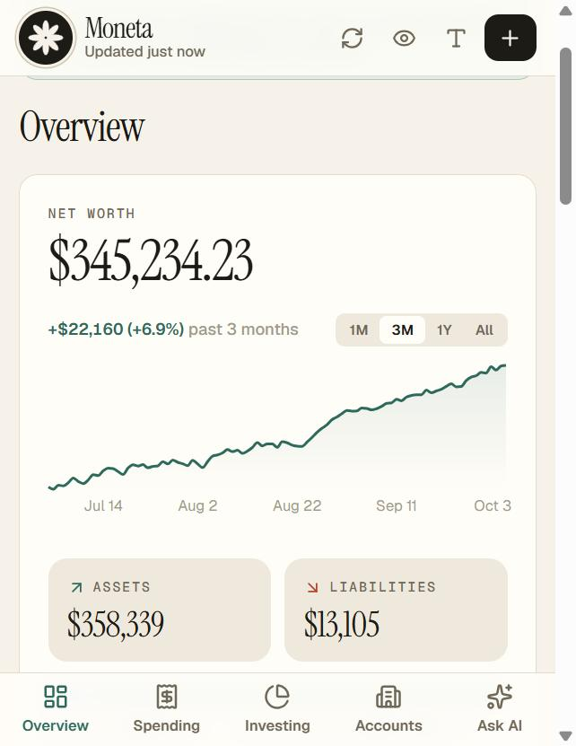
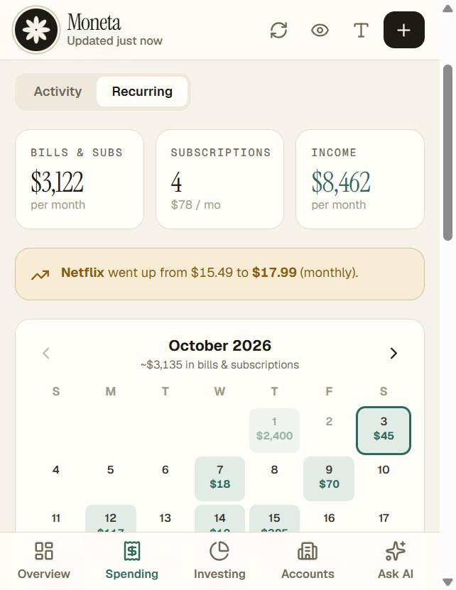
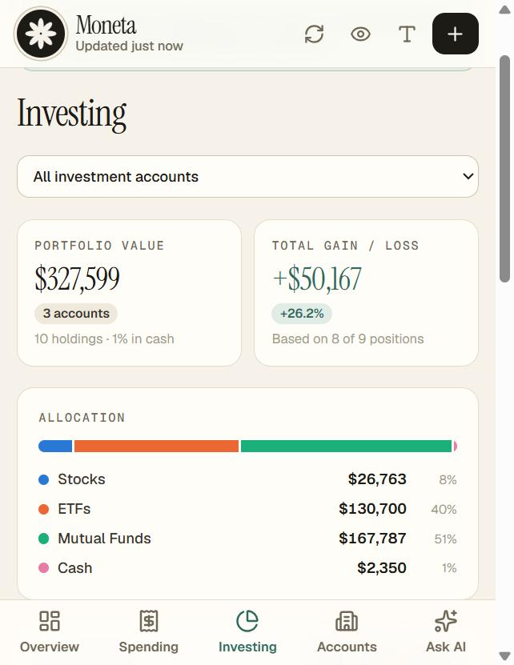
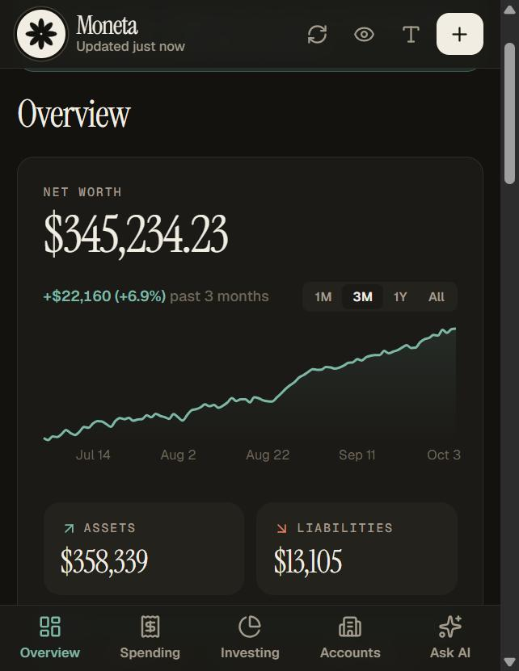

# Moneta

**Your own private personal finance dashboard: free, open source, and self-hosted.**

Moneta is a free alternative to subscription apps like Monarch Money, Copilot, and Origin (and a replacement for the now-shut-down Mint). Connect your bank, credit card, brokerage, and retirement accounts and get your net worth, spending insights, investment holdings, and an AI assistant you can ask about your money.

The difference: **it runs on your own free accounts, with your own keys.** Your financial data lives in your own database, behind your own password. There's no company in the middle, no subscription, and no ads.

<p align="center">
  
  
  
  
</p>
<p align="center"><sub>Screenshots use Moneta's built-in demo data. Try it yourself in one command: <code>npm run demo</code>.</sub></p>

---

## Why "Moneta"?

On the Capitoline Hill in ancient Rome stood a temple to **Juno Moneta**, dedicated in 344 BC. By the 3rd century BC the city's mint was working in or beside it, so the coins of Rome were struck in Moneta's house. Over time her name came to mean the mint itself, and then the coins it made.

Her name lives on in everyday English:

- **money:** Latin *moneta* → Old French *moneie* → English *money*
- **mint:** Latin *moneta* → Old English *mynet* → *mint*
- **monetary**, and coin words in other languages, like the German *Münze*

The Romans usually explained the name with the verb ***monere***, "to warn, to remind, to advise." Moneta was the goddess who warned. Cicero tells of a voice from her temple giving the city advice during an earthquake, and later writers connected her with the sacred geese of Juno, whose honking warned the Romans of a night attack on the Capitol. One poet went further still: in the first Latin translation of the *Odyssey*, Livius Andronicus rendered *Mnemosyne*, the goddess of memory and mother of the Muses, as *Moneta*.

So Moneta is money, memory, and good advice in one name. That's what this app tries to be: a quiet presence that keeps track of your money, reminds you where it went, and answers when you ask. And since it's a free replacement for Mint, it's fitting that the word *mint* itself comes from *Moneta*.

---

## Features

- **Net worth at a glance:** assets, liabilities, and how your money is split between cash and investments.
- **Net worth forecast:** see where your net worth is heading year by year to retirement and beyond, from your real balances and the last 12 months of income and spending. Adjust retirement age, spending and growth assumptions and watch it update; it flags if money would run short.
- **Net worth over time:** Moneta records your balances every day and charts your net worth over 1 month, 3 months, a year, or all time.
- **What changed:** see where a net worth change came from (cash, investments, property, debts), including an estimate of market gains vs. money you added.
- **Monthly recap:** income, spending, savings rate, categories above or below your usual, biggest one-off purchases, and new subscriptions, with an "Ask AI to explain this month" button.
- **Review inbox:** new transactions wait for a quick look. Confirm the category with one tap or fix it, with Undo.
- **Tap any number:** totals, chart days, accounts, and bills open the transactions behind them, and every merchant has its own page with a 12-month history.
- **Manual assets:** add a home, car, crypto wallet, or valuables so your net worth is complete, with an optional yearly appreciation or depreciation estimate.
- **Spending insights:** month-to-date spending vs. the same point last month, spending by category, a daily spending-pace chart, and searchable transactions.
- **Your history, kept:** transactions are stored in your own database, so history keeps growing past what your bank shares, and your edits stick.
- **Automatic categories you can edit:** tap any transaction to rename it, recategorize it, or add a note. Tick "Always do this" and Moneta creates a merchant rule that applies to past and future transactions.
- **Smart transfers:** money moving between your own accounts is matched and hidden automatically. Choose which kinds of transfers (card payments, savings, P2P, buy now pay later, mortgage…) to hide and which to count as spending.
- **Recurring & subscriptions:** bills, subscriptions, and paychecks are detected automatically, with next charge dates, price-increase alerts, and a bills calendar.
- **Investments:** holdings across all your brokerages, combined by ticker, with allocation (stocks, ETFs, funds, bonds, cash), gain/loss, and portfolio weight. A value-over-time chart and filters (account, institution, asset type, taxable vs. retirement) apply to everything on the tab, and each holding has its own history.
- **Accounts:** balances grouped by type, credit card utilization, sync status per bank, one-tap **Reconnect** when a bank needs you to sign in again, and connect/disconnect controls.
- **Ask AI:** chat with an AI model about your own data: *"Where did my money go last month?"*, *"Do I have recurring subscriptions?"*, *"Is my portfolio concentrated?"*
- **Built for your phone:** works great on iPhone/Android. Add it to your home screen and it opens like an app.
- **Privacy touches:** a one-tap "hide amounts" blur for checking your balance in public, and an adjustable text size.
- **Private by default:** a password login protects every page and API route.

## What it costs: $0 for most people

| Piece | What it does | Free tier |
|---|---|---|
| [Vercel](https://vercel.com) | Hosts the app | Hobby plan is free for personal projects |
| [Neon](https://neon.tech) | Postgres database (stores your bank connection tokens) | Free plan |
| [Plaid](https://plaid.com) | Securely connects to 12,000+ banks and brokerages | **Trial plan:** real data from up to **10 connected institutions** free¹ |
| [Groq](https://groq.com) | Runs the AI assistant (optional) | Free API key, no credit card |

¹ Plaid's free Trial plan is for new Plaid teams in the US and Canada and includes Transactions, Balance, and Investments. One "connection" is one login at one institution, so linking Chase plus Fidelity uses 2 of your 10, no matter how many accounts each has. Beyond that, Plaid has a pay-as-you-go plan. Check [Plaid's pricing](https://plaid.com/pricing/) for current terms.

## Try it in one minute (no accounts needed)

```bash
git clone https://github.com/<you>/moneta.git
cd moneta
npm install
npm run demo
```

Open [http://localhost:3001](http://localhost:3001). Demo mode fills Moneta with a realistic, made-up household (paychecks, rent, subscriptions, a brokerage, a 401(k), a year of net worth history) so you can click through everything. It needs no Plaid, database, or password, and never reads real data. Edits stay until you reload.

Want a public demo link? Deploy a separate Vercel project with `DEMO_MODE=true`. Leave `GROQ_API_KEY` unset there unless you're happy for visitors to use your free AI quota.

## Replace your subscription in about 30 minutes

### 1. Get your own copy

Fork this repository on GitHub (or clone it). You'll deploy your fork, so it's yours to customize.

### 2. Create a Plaid account (free)

1. Sign up at [dashboard.plaid.com/signup](https://dashboard.plaid.com/signup).
2. Go to **Developers → Keys** and copy your **client ID** and **sandbox secret**.
3. To use your real accounts, request **Production** access (the free Trial plan) and copy the **production secret**. Until then, sandbox gives you fake test banks to try everything.

### 3. Create a database (free)

Create a project at [neon.tech](https://neon.tech) and copy its connection string (`postgresql://…`). The app creates its table automatically on first use.

> Tip: if you deploy on Vercel, you can add Neon from the **Vercel Marketplace** (Storage tab) instead, and it fills in `DATABASE_URL` for you.

### 4. (Optional) Get an AI key (free)

Create a key at [console.groq.com/keys](https://console.groq.com/keys). For extra privacy, turn on **Zero Data Retention** under *Settings → Data Controls* so Groq doesn't store your requests.

### 5. Deploy to Vercel

1. In [Vercel](https://vercel.com/new), import your fork.
2. Add these **Environment Variables** (see [`.env.example`](.env.example) for details):

   | Variable | Required | Value |
   |---|---|---|
   | `APP_PASSWORD` | ✅ | The password you'll sign in with. Make it long and unique. |
   | `PLAID_CLIENT_ID` | ✅ | From Plaid |
   | `PLAID_SECRET` | ✅ | Sandbox or production secret (must match `PLAID_ENV`) |
   | `PLAID_ENV` | ✅ | `sandbox` to test, `production` for real accounts |
   | `DATABASE_URL` | ✅ | Neon connection string |
   | `GROQ_API_KEY` | | Enables the Ask AI tab |
   | `GROQ_MODEL` | | Override the AI model (default `openai/gpt-oss-120b`) |
   | `CRON_SECRET` | | Any long random string. Turns on the daily background sync |
   | `DEMO_MODE` | | `true` shows made-up demo data with no login. Only for a separate demo deployment |
   | `PLAID_REDIRECT_URI` | | `https://<your-app>.vercel.app/oauth`, see [Phone + big banks](#phone--big-banks) |

3. Click **Deploy**.

### 6. Sign in and link your accounts

Open your app, sign in with `APP_PASSWORD`, and tap **Link account**:

- **Bank or credit card** for checking, savings, credit cards, and loans.
- **Brokerage or retirement** for Fidelity, Vanguard, Schwab, Robinhood, 401(k), IRA, HSA…

A setup checklist on the first screen shows anything that's still missing. In sandbox mode, use username `user_good` and password `pass_good`.

### 7. Cancel your old subscription 🎉

Before you do, note what Moneta doesn't have yet (see [Limitations](#limitations)), and export anything you want to keep from your old app.

### Phone + big banks

Some large banks (Chase, Capital One, Wells Fargo…) send you to their own website to sign in (OAuth). On a computer this just works. On a phone it works best if Plaid can send you back to your app afterwards:

1. Set `PLAID_REDIRECT_URI` to `https://<your-app>.vercel.app/oauth`.
2. Add that exact URL in the Plaid Dashboard under **Developers → API → Allowed redirect URIs**.

**Add to Home Screen:** in Safari, tap **Share → Add to Home Screen**.

## Run it locally

```bash
git clone https://github.com/<you>/moneta.git
cd moneta
npm install
cp .env.example .env.local   # then fill in the values
npm run dev
```

Open [http://localhost:3000](http://localhost:3000) and sign in with your `APP_PASSWORD`.

## Security & privacy

- **One user, one password.** Moneta is designed for a single person (or household) per deployment. Every page and API route requires signing in. Sessions are signed, HTTP-only cookies that last 30 days, and changing `APP_PASSWORD` signs out every device.
- **Your data stays in your accounts.** Plaid access tokens, transactions, and daily balances are stored in *your* Neon database and nowhere else. Keep `DATABASE_URL`, your Plaid secret, and `CRON_SECRET` private.
- **AI is opt-in.** If you set `GROQ_API_KEY`, each question sends a summary of your accounts, holdings, and recent transactions to Groq to generate the answer. Turn on Zero Data Retention in Groq, or leave the key unset to disable AI entirely.
- **Disconnect anytime.** *Accounts → Connections → Disconnect* revokes the connection at Plaid and deletes its token, transactions, and balance history from your database.

## Limitations

Moneta is young. Compared with paid apps, it currently doesn't have:

- Budgets or savings goals
- Splitting a transaction across categories
- Importing history from other apps. Moneta keeps everything from the day you connect, plus whatever history your bank shares through Plaid: up to 2 years for new connections, often 90 days for older ones
- Investment performance over time
- Multiple users or shared household logins
- Manual accounts (house, car, crypto wallets)

Contributions are welcome. See below.

## How it works

- **Next.js** (App Router) on Vercel; **Tailwind CSS** for styling; **Recharts** for charts.
- **Plaid** for bank and brokerage data: `/accounts/get` (balances), `/transactions/get` (90 days), `/investments/holdings/get`.
- **Neon Postgres** stores your Plaid access tokens, synced transactions (with your edits), daily balances, merchant rules, and settings. Tables are created automatically.
- **Plaid `/transactions/sync`** pulls only what changed since the last sync. The dashboard syncs when data is older than 10 minutes, and **Vercel Cron** (`vercel.json`) syncs daily at 10:00 UTC.
- **Groq** (OpenAI-compatible API) answers chat questions from a compact text snapshot of your data.

```
src/
  app/
    page.tsx            Dashboard shell (tabs, header, states)
    login/              Password login page + server actions
    oauth/              Plaid OAuth redirect handler (phones + big banks)
    api/
      dashboard/        All financial data in one call (syncs if stale)
      transactions/     Edit a transaction (category, name, note, merchant rule)
      rules/            Delete a merchant rule
      settings/         Transfer rules, dismissed recurring items
      cron/sync/        Daily background sync (Vercel Cron)
      chat/             AI assistant (streams from Groq)
      plaid/            Link token, token exchange, disconnect
      setup-status/     Which env vars are configured (booleans only)
  components/           Overview, Spending, Investments, Accounts, Assistant…
  lib/
    plaidData.ts        Fetches + combines data from every connected bank
    transactionStore.ts Plaid sync → Postgres, balance snapshots, net worth history
    transfers.ts        Internal transfer matching + per-type transfer rules
    recurring.ts        Recurring bill/subscription/income detection
    demoData.ts         Made-up demo household for DEMO_MODE / npm run demo
    financialContext.ts Builds the AI's data snapshot
    finance.ts          Categories, formatting, spending math
    session.ts          Signed session cookies
  proxy.ts              Requires sign-in for every route
```

## Contributing

Issues and pull requests are welcome, especially for anything in [Limitations](#limitations). Please never include real financial data, API keys, or screenshots with real balances in issues or PRs. Use `npm run demo` for screenshots.

## License

[MIT](LICENSE): free to use, modify, and share.

## Disclaimer

Moneta is provided as-is, without warranty. It isn't financial advice, and the AI assistant can make mistakes. Not affiliated with Plaid, Groq, Vercel, Neon, or any of the apps mentioned above.
